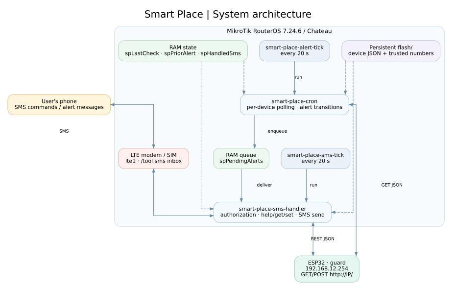
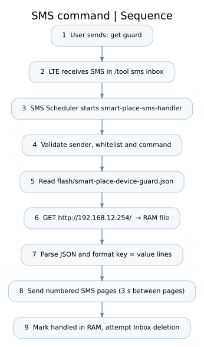
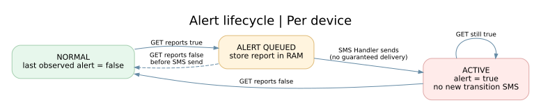

# Smart Place

**An SMS-to-REST gateway for local IoT devices, built on MikroTik RouterOS and LTE.**

Smart Place lets you check sensors, control supported devices, and receive event-driven alerts by ordinary text message. The router receives SMS commands through its LTE modem and talks to devices on the local network using HTTP and JSON. No cloud application or public internet endpoint is required for this workflow.

> **Hardware and software profile:** MikroTik Chateau, RouterOS **7.24.6**, LTE interface **`lte1`**. The reference device is an ESP32 called **`guard`** at **`192.168.12.254`**. Other RouterOS models and modems may require adaptation and testing.
>
> **Safety:** Smart Place is an auxiliary notification and control gateway. It is **not** a certified gas, fire, security or life-safety system. SMS delivery can fail or be delayed; never depend on it as the sole protection against a hazardous condition.

**On this page**

- [1. Overview](#overview) — what Smart Place does and who it is for
- [2. Architecture](#architecture) — components, data flow, and alert lifecycle
- [3. Installation](#installation) — a clean MikroTik LTE setup, step by step
- [4. Using Smart Place](#using-smart-place) — SMS commands and alert messages
- [5. Device configuration](#device-configuration) — JSON reference and adding devices
- [6. Alert processing](#alert-processing) — timing, queueing, and reset behavior
- [7. Security](#security) — trusted numbers and operating boundaries
- [8. Operations](#operations) — monitoring, upgrades, backup, recovery
- [9. Troubleshooting](#troubleshooting) — known errors and diagnostics
- [10. Reference](#reference) — commands, files, runtime state, and limitations

---

<a id="overview"></a>
## 1. Overview

### 1.1 What is Smart Place?

Smart Place turns a compatible MikroTik LTE router into a bridge between **SMS** and **local REST APIs**. You can send a short command from a mobile phone and get a response without having to open a web browser, connect to a VPN, or expose the IoT device to the internet.

For example, you send:

```text
get guard
```

The router asks the ESP32 for its current JSON status and sends back readable text such as:

```text
CO2 = 605
Gas (MQ9) = 29
Temperature 1 = 30.6
Humidity 1 = 35.1
Relay 1 = 1
alert = false
```

These are **example measurements**, not fixed values. Actual results depend on the device's API. Long reports are sent as multiple numbered SMS messages.

### 1.2 What can I do with it?

| Feature | What it means in practice |
|---|---|
| **Read sensor values** | Ask for temperature, humidity, pressure, CO₂, gas measurements, relay states or any other keys supplied by a device. |
| **Send control commands** | Forward a JSON array/object or key/value pairs as an HTTP POST to a device. |
| **Get automatic alerts** | Receive SMS when a configured device reports a transition to `"alert": true`. |
| **Use several devices** | Add a separate JSON config file for each compatible device without adding a new RouterOS script. |
| **Restrict access** | Define trusted international phone numbers that can use commands and receive alert messages. |
| **Operate locally** | HTTP traffic remains between the MikroTik and local devices; the remote messaging channel is SMS. |

### 1.3 Example use cases

**Remote status check:** You are away from the building and want to know whether a temperature sensor or a relay is active. Send `get guard` and read the returned values.

**Simple remote control:** An ESP32 exposes five relay states through an HTTP POST API. Send `set guard [0,0,0,0,0]` to submit that JSON array. The ESP32, not Smart Place, decides what the array means and whether to accept it.

**Gas alarm notification:** A sensor controller detects a threshold crossing and returns `"alert": true`. Smart Place polls it, records the change, and sends an alert report to each configured trusted number.

### 1.4 What Smart Place is not

Smart Place does not install ESP32 firmware, provide a hosted dashboard, store long-term sensor history, guarantee SMS delivery, encrypt the local HTTP connection, or validate the physical safety of relay operations. The IoT device must already implement the agreed REST API.

### 1.5 Supported and demonstrated behavior

The current reference deployment has demonstrated local HTTP GET returning `200 OK`, JSON formatting, `help` and `get` SMS responses, a successful HTTP POST response for `set`, automatic Scheduler execution, gas-alert notification with **four SMS parts received**, and return to `alert=false` after the alarm condition cleared.

The reference deployment also encountered **`MBIM: MEMORY_FULL (6)`** during SMS sending. The fact that one alert test delivered all four messages does **not** establish reliable unattended delivery. Multi-recipient authorization and repeated alarms after a full reset have not been exhaustively tested.

---

<a id="architecture"></a>
## 2. Architecture

### 2.1 System diagram



Smart Place separates **SMS handling** from **device polling**. The two jobs exchange pending alerts through RouterOS RAM state; only the SMS Handler sends messages through the LTE modem.

### 2.2 Components

| Component | Responsibility |
|---|---|
| **Mobile phone** | Sends `help`, `get`, and `set`; receives status and alerts. |
| **LTE modem / `lte1`** | Receives and transmits SMS via `/tool sms`; contains the active SIM. |
| **`smart-place-sms-handler`** | Reads the SMS Inbox, checks sender/command access, processes commands, calls local REST endpoints, formats/sends replies, and delivers pending alerts. |
| **`smart-place-cron`** | Discovers device JSON configurations, polls enabled devices, recognizes changes in their `alert` value, and queues alert reports. It does **not** send SMS directly. |
| **`smart-place-sms-tick`** | Runs the SMS Handler every **20 seconds**. |
| **`smart-place-alert-tick`** | Runs the polling script every **20 seconds**. |
| **`smart-place-selftest`** | Reads the `guard` configuration and performs a **read-only HTTP GET** and JSON parsing test. |
| **`flash/smart-place-device-*.json`** | Persistent per-device settings: IP, command modes, alert enablement and polling period. |
| **`flash/smart-place-trusted-numbers.txt`** | Persistent list of authorized phone numbers and alert recipients. |
| **RouterOS RAM globals** | Last check times, previously observed alert states, handled SMS identifiers, and pending alerts. |
| **ESP32 or other local device** | Returns JSON for GET and optionally accepts a JSON POST. |

### 2.3 Command sequence



When the phone sends `get guard`, the sequence is:

1. The operator delivers the SMS to the SIM in the router.
2. RouterOS exposes it in `/tool sms inbox`.
3. `smart-place-sms-tick` starts `smart-place-sms-handler` on its next run.
4. The Handler checks that the sender is a plausible international number, matches the trusted list, and issued a supported command.
5. It locates `flash/smart-place-device-guard.json`, reads it, and parses the configuration.
6. It makes `GET http://192.168.12.254/` using `/tool fetch output=file` with a temporary **RAM file**.
7. It turns the JSON response into the configured text format.
8. It sends numbered SMS pages through `lte1`, with a **3-second gap between submissions**.
9. It records the SMS identifier as handled in RAM and tries to remove the incoming command from the Inbox.

The last two actions are not proof of end-to-end SMS delivery. The Handler can submit an SMS successfully while the operator delays it, or the modem can return an error after partial submission.

### 2.4 Alert state diagram



The polling script compares the device's current JSON `alert` flag to its previous observed state. A transition from false (or unknown after restart) to true queues a report. Continued true readings should not create a new report for every poll. A later false reading resets the state so a subsequent true can create a new alert.

### 2.5 Storage and execution model

**Persistent data** lives under `flash/`. These files survive router reboots and are not overwritten by the installer. The installer itself, stored as `smart-place-install.rsc`, does not need to remain on the router after installation if a backup exists elsewhere.

**Volatile state** lives in RouterOS RAM: `spLastCheck`, `spPriorAlert`, `spPendingAlerts`, and `spHandledSms`. This is intentionally low-write, but rebooting or re-importing the installer clears it. Consequently, queued alerts can be lost, the first poll may treat an already active condition as a new alert, and a retained Inbox command may become eligible for processing again.

**HTTP responses** are temporarily written to RAM files in the root Files area (`smart-place-*-http.txt`), then read and removed. On the tested Chateau, `flash/` is the persistent area and the other root Files entries are RAM-backed. This behavior must be checked on other models.

### 2.6 Trust boundaries

The phone communicates over SMS; the router authenticates **only by sender number comparison**, not by a cryptographic signature. The router communicates with ESP32 over **plain HTTP** on the local network. Protect both the SIM and the local network, especially because `set` can affect physical outputs.

---

<a id="installation"></a>
## 3. Installation on a clean MikroTik LTE router

This procedure installs the **current implementation** without changing the ESP32 firmware. It assumes a compatible RouterOS 7 system with a working SMS-capable LTE modem, a `flash/` directory, and a reachable local REST device. Commands below use the tested interface `lte1` and example device `guard`.

### 3.1 Prerequisites

| Item | Required condition |
|---|---|
| Router | MikroTik running RouterOS 7; **7.24.6** is the validated reference version. |
| LTE | A SIM with an active SMS service and an LTE interface accessible as `lte1`. |
| LAN | The router can reach the device IP address by a local route or bridge. |
| Device | `GET http://192.168.12.254/` returns valid JSON, including an `alert` boolean for alert monitoring. |
| Storage | A persistent `flash/` directory for configs, plus enough working space for a temporary response file. |
| Access | WinBox or terminal access with permission to manage files, scripts, Scheduler, SMS and network settings. |
| Files | The [installer](downloads/smart-place-install.rsc) and a [device configuration example](downloads/smart-place-device-guard.example.json). |

> **Compatibility boundary:** The installer hardcodes `lte1`, `flash/`, script names and Scheduler names. If your router uses different names or storage paths, review and adapt the RSC **before import**. An installer import does not configure LTE connectivity, IP addresses, an ESP32, or the SIM subscription.

### 3.2 Prepare RouterOS, LTE and the local device

1. Complete MikroTik's normal initial setup, set a strong administrator password, and restrict router management to trusted networks. Keep a backup of the router's current configuration.
2. Insert a working SIM with SMS support; unlock or configure its PIN if needed, according to the router/modem documentation.
3. Verify the LTE interface:

   ```routeros
   /interface lte print
   /interface lte monitor lte1 once
   ```

4. Enable the SMS receiver:

   ```routeros
   /tool sms set receive-enabled=yes port=lte1
   /tool sms print
   ```

   Look for `status: running`, `receive-enabled: yes`, and `port: lte1`. SMS commands used by Smart Place are **plain text** such as `get guard`; they do **not** require RouterOS's separate built-in remote-command SMS syntax.
5. Ensure the ESP32 and router are on a connected local network. The router must have a route to `192.168.12.254`; configure the appropriate bridge, VLAN, or interface for **your** topology. Do not blindly add a second `192.168.12.0/24` network if one already exists.
6. Check connectivity:

   ```routeros
   /ping 192.168.12.254 count=4
   ```

   ICMP may be disabled on some devices, so the definitive check is the HTTP GET in the Smart Place self-test.

### 3.3 Install the persistent configuration files

Open **WinBox → Files → `flash/`**. Create or upload these two files with the exact names:

```text
flash/
├── smart-place-device-guard.json
└── smart-place-trusted-numbers.txt
```

**Device configuration** — save as `flash/smart-place-device-guard.json`:

```json
{
  "name": "guard",
  "ip": "192.168.12.254",
  "alert": true,
  "interval": 60,
  "help": "Guard: get guard | set guard [1,0,0,1,0]",
  "get": "flat",
  "set": "auto",
  "wrap": ""
}
```

**Trusted numbers** — save as `flash/smart-place-trusted-numbers.txt`, using **your actual phone number**, in international format:

```text
+<COUNTRY_CODE><PHONE_NUMBER>
```

The placeholder above is explanatory; replace it with a real number using digits after the leading `+` (for example, `+12345678901`). Each additional trusted number goes on its own line. Do not surround the numbers with quotes or add labels/comments.

> **Important:** A file that exists but has **zero bytes** explicitly enables command access from **any syntactically valid international phone number**. This is a test-only mode and permits `set` operations. For deployment, populate the list **before** enabling the SMS Scheduler. A missing or malformed readable list is denied. **If file contents are unreadable due to a permission error, the current Handler may mistake `nil` for an empty file and treat access as public.** Keep both Scheduler policies correct and verify the trusted list from the active context; this is an outstanding hardening limitation.

Use these commands to verify that the router sees the files:

```routeros
/file print where name~"smart-place"
:put [/file get [find name="flash/smart-place-device-guard.json"] contents]
:put [/file get [find name="flash/smart-place-trusted-numbers.txt"] contents]
```

Do not put the installer inside the `flash/` configuration naming pattern. Keep the `.json` file plain UTF-8 text without comments or trailing commas.

### 3.4 Import the installer

Upload `smart-place-install.rsc` to the **root** of WinBox Files, rather than to `flash/`.

Run a syntax/dry-run check:

```routeros
/import file-name=smart-place-install.rsc verbose=yes dry-run
```

If no import errors are reported, run:

```routeros
/import file-name=smart-place-install.rsc
```

The installer creates exactly **three RouterOS scripts** and **two disabled schedulers**:

```text
/system script
  smart-place-selftest
  smart-place-sms-handler
  smart-place-cron

/system scheduler
  smart-place-sms-tick   disabled=yes, interval=20s
  smart-place-alert-tick disabled=yes, interval=20s
```

The Scheduler policy of **both** tasks must include `sensitive`:

```text
ftp,read,write,test,policy,sensitive
```

On the tested RouterOS 7.24.6 Chateau, an automated Scheduler without `sensitive` could find a JSON file while `/file get ... contents` returned `nil`. The current installer sets the necessary policy. Do not remove `sensitive` from either Scheduler.

Verify installation:

```routeros
/system script print where name~"smart-place"
/system scheduler print detail where name~"smart-place"
```

### 3.5 Run the read-only self-test

```routeros
/system script run smart-place-selftest
```

A healthy result includes messages similar to:

```text
Worker config loader: OK (... bytes)
Cron config loader: OK (... bytes)
name=guard ip=192.168.12.254
set mode=auto get mode=flat
Testing GET only; NO POST and NO SMS
status: finished
code: 200
CO2 = ...
Gas (MQ9) = ...
alert = false
Dry-run key/value POST body:
{"d":2,"r":4}
Self-test finished
```

The `Worker config loader` line is a **legacy diagnostic label** in the current self-test; the active SMS script is called `smart-place-sms-handler`. This test does **not** issue a POST, change relays or send SMS.

### 3.6 Test the SMS Handler manually

Before enabling Scheduler, examine the Inbox and remove **only messages you have identified as old and already executed**; a retained `set` message is especially risky after a reinstall.

```routeros
/tool sms inbox print detail
```

Send an SMS from a trusted phone to the SIM number:

```text
help guard
```

Then run:

```routeros
/system script run smart-place-sms-handler
```

You should receive the help text configured in `guard.json`. Repeat with `get guard` and check that sensor values are delivered in numbered SMS pages. A standalone `1` printed by the script may be output from an internal `count-only` command; it is not, by itself, an error code.

If a response is missing, check the latest log entries rather than repeating `set` blindly:

```routeros
/log print where message~"SmartPlace:"
/tool sms inbox print detail
/system script job print detail
```

### 3.7 Test background polling manually

```routeros
/system script run smart-place-cron
```

This script sends **no SMS directly**. It reads configurations and polls alert-enabled devices. A successful HTTP GET commonly appears in the terminal; in normal operation it need not write an informational log for every poll. If `guard` returns `alert=false`, no alarm is queued.

### 3.8 Enable automatic operation

Enable the **alert Scheduler first**:

```routeros
/system scheduler enable [find name="smart-place-alert-tick"]
/system scheduler print detail where name="smart-place-alert-tick"
```

Observe that `run-count` increases and that new `cron failure` warnings do not appear.

When the trusted-number list is correctly populated, the Inbox is understood, and the modem is ready, enable the **SMS Scheduler**:

```routeros
/system scheduler enable [find name="smart-place-sms-tick"]
/system scheduler print detail where name="smart-place-sms-tick"
```

Now send `help guard` without manually running the Handler. The reply should arrive automatically. Then check `get guard`. Do not use a live gas release as the routine way to test alert delivery; prefer a controlled software simulation at the device if supported.

### 3.9 Final commissioning checklist

- [ ] RouterOS and `lte1` are operational; SMS reception is running.
- [ ] `GET http://<device-ip>/` returns valid JSON.
- [ ] Device configuration is stored under the exact `flash/` filename.
- [ ] The trusted-number file contains only intended recipients and is **not empty**.
- [ ] The installer completed successfully and created three scripts and two Schedulers.
- [ ] Both Scheduler policies include `sensitive`.
- [ ] Self-test finishes with HTTP 200.
- [ ] A manual and an automatically triggered `help guard` work.
- [ ] `get guard` returns readable data; any missing SMS page is investigated.
- [ ] Cron runs on schedule without new `Empty device config` warnings.
- [ ] Alert/reset behavior is tested safely; SMS delivery limitations are understood.

---

<a id="using-smart-place"></a>
## 4. Using Smart Place

Commands are **case-sensitive**, simple text messages. Use lowercase command names and a device name that matches its configuration file. The examples below assume the registered device name is `guard`.

### 4.1 Command quick reference

| SMS text | Result |
|---|---|
| `help guard` | Returns the device-specific help string from JSON configuration. |
| `get guard` | Sends HTTP GET to the configured device and returns its response. |
| `set guard [0,0,0,0,0]` | Sends the JSON array in an HTTP POST body. |
| `set guard {"d":2,"r":4}` | Sends a JSON object in an HTTP POST body. |
| `set guard d 2 r 4` | Converts key/value pairs to JSON and POSTs `{"d":2,"r":4}`. |

Do not include a leading slash, quotes around the entire SMS, or RouterOS commands. Only `help`, `get`, and `set` are recognized by this version.

### 4.2 `help`: device-specific instructions

```text
help guard
```

The reply comes from the `help` field in the matching JSON configuration. It is **not automatically generated** from the ESP32 API. Update that configuration string if the device's capabilities change.

### 4.3 `get`: read current status

```text
get guard
```

The gateway sends:

```http
GET http://192.168.12.254/
```

A typical compatible JSON response might be:

```json
{
  "CO2": 605,
  "Gas (MQ9)": 29,
  "Temperature 1": 30.6,
  "Relay 1": 1,
  "alert": false
}
```

With `"get": "flat"`, the user sees lines such as:

```text
CO2 = 605
Gas (MQ9) = 29
Temperature 1 = 30.6
Relay 1 = 1
alert = false
```

With `"get": "raw"`, the Handler returns the raw response body instead. When `flat` is enabled, first-level keys are flattened; nested objects and arrays are displayed as compact JSON values, not recursively flattened into separate keys.

### 4.4 Understanding multi-part SMS

Long replies are split into **separate** numbered SMS messages:

```text
guard 1/4: CO2 = ...
guard 2/4: ...
guard 3/4: ...
guard 4/4: ...
```

The number of parts varies with the response. The current implementation allows **64 characters of content per page**, a maximum of **8 pages**, and a **3-second delay** between SMS submissions. Overlong reports are shortened and marked `[TRUNCATED]`. These are individual SMS messages, not one concatenated carrier-level message; delivery order is not guaranteed.

If only three of four parts arrive, the data is incomplete. Look for `SMS part 3/4 failed` in the router log and do not infer that the missing data was zero or unchanged.

### 4.5 `set`: submit device commands

**Raw JSON array**:

```text
set guard [0,0,0,0,0]
```

HTTP request:

```http
POST http://192.168.12.254/
Content-Type: application/json

[0,0,0,0,0]
```

**Raw JSON object**:

```text
set guard {"d":2,"r":4}
```

**Key/value pairs**:

```text
set guard d 2 r 4
```

The latter is serialized as JSON:

```json
{"d":2,"r":4}
```

Key/value input requires pairs separated by spaces. Values that are valid JSON literals are parsed as such (for example `2`, `true`, `false`, `null`); other values are sent as JSON strings. Keys are restricted to letters, digits, underscores and hyphens.

The meaning of each key or array position is **defined by the ESP32 firmware**, not by Smart Place. Do not assume that relay positions are reversible, that `0` always means physically safe, or that every device uses the same command body.

If the device responds with JSON, the Handler formats that response according to the configured GET format. If the response body is empty, it reports `POST OK (empty response)`. An SMS indicating that an HTTP request succeeded is not independent verification that a physical actuator reached the desired state.

> **Avoid duplicate control actions:** If the POST succeeds but the reply SMS is lost, **do not immediately resend `set`**. Query the resulting state with `get` first. The system intentionally does not automatically replay POSTs.

### 4.6 Receiving an automatic alert

For an alert-enabled device that changes to `"alert": true`, each trusted phone can receive a report titled `ALERT guard!`. A long alert may arrive as several numbered SMS pages. Alerts are sent by the SMS Handler after polling has queued the event; neither the polling scheduler nor the ESP32 sends an SMS itself.

To acknowledge the situation, check the environment and follow the physical safety procedure appropriate for the sensor. A later `get guard` can show whether the device has returned `alert=false`, but **SMS does not replace a physical alarm or emergency response**.

---

<a id="device-configuration"></a>
## 5. Device configuration

### 5.1 Naming convention

Each device has exactly one file under:

```text
flash/smart-place-device-<device-name>.json
```

The SMS device name must match both the filename and the JSON `name` field. For `guard`, all three are aligned:

```text
SMS:      get guard
File:     flash/smart-place-device-guard.json
JSON:     "name": "guard"
```

Device names accepted by the SMS Handler contain letters, digits, `_` and `-`. For compatibility, use short lowercase ASCII names without spaces.

### 5.2 JSON configuration reference

| Field | Type | Example | Meaning |
|---|---|---|---|
| `name` | String | `"guard"` | Required matching logical device name. |
| `ip` | String | `"192.168.12.254"` | Host used in `http://<ip>/` GET and POST URLs. |
| `alert` | Boolean | `true` | Enables periodic alert polling **for this device**. This is not the observed alarm state. |
| `interval` | Number | `60` | Minimum seconds between polls for a device with `alert=true`; must be **at least 20**. |
| `help` | String | `"Guard: get guard ..."` | Reply body for `help <device>`. |
| `get` | String | `"flat"` | `flat` converts first-level JSON keys to lines; `raw` returns the original response body. |
| `set` | String | `"auto"` | Current implementation supports `auto` mode for JSON bodies and key/value pairs. |
| `wrap` | String | `""` | If nonempty, wraps a **raw JSON array** in an object under the named key. |

The installer does **not** create, overwrite, or migrate device JSON files. They are part of the operator's persistent configuration.

### 5.3 How `wrap` changes POST

With:

```json
"wrap": ""
```

`set guard [1,0,0,1,0]` is sent as a bare JSON array:

```json
[1,0,0,1,0]
```

With:

```json
"wrap": "relays"
```

the same SMS becomes:

```json
{"relays":[1,0,0,1,0]}
```

The wrapper applies to **raw array input**; a raw JSON object or key/value pairs are not wrapped by this implementation. Set this field only after checking the device's API specification.

### 5.4 Adding a second device

To add a compatible device called `pump`:

1. Assign it a stable, reachable LAN IP address and provide the expected HTTP endpoint.
2. Upload `flash/smart-place-device-pump.json` with `"name": "pump"` and its real IP.
3. Select a `get` mode supported by the Handler (`flat` or `raw`), `set=auto`, and a suitable `help` string.
4. Set `alert=true` and an interval of at least 20 seconds only if it provides a meaningful boolean `alert` field.
5. Send `help pump` and `get pump`. Test any `set pump ...` operations only when physically safe.

No new RouterOS script is required. The cron discovers matching `.json` files on each run, and the SMS Handler resolves the requested filename dynamically. Each device is polled sequentially, so many devices or slow HTTP endpoints increase latency.

### 5.5 REST contract

**Read endpoint:** `GET http://<ip>/` returns valid JSON. A JSON object with first-level fields is the common status format.

**Write endpoint:** `POST http://<ip>/` accepts `Content-Type: application/json` and an application-specific JSON payload.

**Alert contract:** When alert polling is enabled in the config, the device must expose a boolean status field named exactly `alert`. `true` signals an active condition; `false` clears it. A different field name or a string such as `"true"` is not equivalent to the boolean `true` expected by cron.

The gateway assumes plain HTTP on the root path `/`. Paths, authentication headers, HTTPS, device-specific parsing rules, retries, and rate limits are **not configurable** through the current JSON schema. Those require implementation changes and separate testing.

---

<a id="alert-processing"></a>
## 6. Alert processing

### 6.1 Two different `alert` settings

Do not confuse these two values:

```json
{ "alert": true }
```

means **monitor this device**. In contrast:

```json
{"alert": true}
```

in the HTTP GET response means **the device currently reports an alarm**.

### 6.2 Polling frequency and latency

The `smart-place-alert-tick` Scheduler wakes up every **20 seconds**. The cron tracks the last poll time per device in RAM and performs the device GET only when its configured `interval` has elapsed. The reference `guard` uses **60 seconds**.

When a new alert is queued, the SMS Handler normally runs within its own **20-second Scheduler cycle**. Sending a four-page report involves three **3-second inter-page delays** in addition to modem and operator processing. These figures describe software timing; **they are not a hard upper bound on detection or SMS delivery**.

### 6.3 Transition behavior

| Previous observed state | New GET status | Expected behavior |
|---|---|---|
| `false` | `false` | No alert sent. |
| `false` | `true` | Queue one new alert report. |
| `true` | `true` | Do not queue a fresh alert for every poll. |
| `true` | `false` | Reset the state, ready for a later alarm. |
| Unknown (after reboot/import) | `true` | May be considered a new transition and queued. |

The implementation stores the most recent pending alert per device in a **RAM map**, not a durable message queue. A restart, re-import, or failure during SMS delivery can lose or duplicate an alert. The Handler currently clears the pending queue before it tries to send; a failed SMS is logged but not guaranteed to be retried.

### 6.4 Trusted recipients

Each configured trusted number receives an alert report when the SMS Handler processes the pending event. With a deliberately empty trusted-number file, commands are open to valid international senders but **automatic alerts have no recipients**. For reliable operation and access control, always use an explicit list.

### 6.5 Safe alert testing

Use the ESP32's development/test mode to simulate a boolean `alert=true` **without introducing gas, smoke or other real hazards**. Observe the report, then restore `alert=false` and confirm the device responds with a normal state. If testing another transition later, do so with the same safe simulated input.

This test confirms the software path only. It does not certify the sensor, alarm threshold, operator network, or delivery guarantees.

---

<a id="security"></a>
## 7. Security

### 7.1 Trusted-number policy

The file `flash/smart-place-trusted-numbers.txt` is the application's command-access and alert-recipient list. Use **one international `+`-prefixed number per line**, with digits only after the prefix.

| File state | Command access | Automatic alert recipients |
|---|---|---|
| Missing or malformed (readable) | Denied by the current validation logic. | None. |
| Unreadable contents because of a permission issue | **Potentially unsafe:** the current code can treat `nil` as an empty file. Correct Scheduler permissions before enabling SMS. | No dependable recipient list. |
| Exists and is **exactly empty** | Any syntactically valid international sender may issue supported commands. | None. |
| One valid number | That exact sender only. | That number. |
| Several valid numbers | Only the listed senders. | All listed numbers. |

Numbers must match the format reported by `/tool sms inbox`; whitespace or a different prefix may prevent matching. A number with the correct syntax is not proof of identity, and sender-number checks are **not cryptographic authentication**. Remove any testing-only public-access setup before connecting sensitive actuators.

The Handler skips alphanumeric service senders such as operator names and ignores unsupported or corrupted text rather than replying to them. Such messages may remain in the Inbox for manual review.

### 7.2 Secure the router and local API

- Restrict WinBox, SSH and other management services to administrator networks and accounts.
- Use firewall rules and network segmentation to restrict who can reach the ESP32's HTTP endpoint.
- Do not expose ESP32 port 80 or RouterOS management services publicly to make SMS operation work; inbound public IP access is not needed.
- Treat `set` as potentially safety-critical: only authorized personnel should know the SMS SIM number and be present in the trusted-number list.
- Store backups of trusted numbers privately. Avoid publishing phone numbers, SIM information or management credentials in a public repository.
- If the IoT device is safety-relevant, implement physical interlocks and local fail-safe logic independently of SMS.

### 7.3 Privacy and operator considerations

SMS may be stored or processed by telecom providers, and the router may log sender numbers and modem errors. Alert replies may reveal environmental conditions, device names or relay states. Evaluate whether this data should be sent over SMS at all.

---

<a id="operations"></a>
## 8. Operations, updates and recovery

### 8.1 See what's running

```routeros
/tool sms print
/system script print where name~"smart-place"
/system scheduler print detail where name~"smart-place"
/system script job print detail
```

A working pair of automated tasks has `disabled=no`, the intended **20-second** interval, and increasing `run-count`. `run-count` proves the scheduler fired, not that each HTTP GET or SMS was successful. Always review errors alongside it.

### 8.2 Useful logs

```routeros
/log print where message~"SmartPlace:"
/log print where message~"SmartPlace: cron failure"
/log print where message~"SmartPlace: SMS part"
/log print where topics~"script,warning"
```

Logs can include historic messages from older installations. Compare **timestamps** and the active version's script names rather than treating all older warnings as current failures.

### 8.3 Stop or restart automated operation

To stop background polling **without stopping command replies**:

```routeros
/system scheduler disable [find name="smart-place-alert-tick"]
```

To stop automated SMS command handling and outgoing alert delivery:

```routeros
/system scheduler disable [find name="smart-place-sms-tick"]
```

To resume:

```routeros
/system scheduler enable [find name="smart-place-alert-tick"]
/system scheduler enable [find name="smart-place-sms-tick"]
```

If a script is still running, inspect `/system script job print detail` before interrupting it. Stopping a job does not retract HTTP POSTs or SMS already submitted.

### 8.4 Backup

Keep copies of **all persistent inputs** outside the router:

```text
smart-place-install.rsc
flash/smart-place-device-guard.json
flash/smart-place-device-<other-device>.json
flash/smart-place-trusted-numbers.txt
```

Also back up the MikroTik's relevant network configuration and record the RouterOS version, LTE interface name, connected subnet, and ESP32 firmware/API behavior. Because pending alerts and handled-message IDs are in RAM, they cannot be recovered from a backup of these files.

### 8.5 Reinstalling or upgrading Smart Place

The installer is **idempotent with respect to its named components**. Re-importing it disables and replaces known Smart Place scripts/Schedulers (and a few older migration names); it does **not** overwrite device configs or trusted numbers. It resets in-RAM state and leaves both new Schedulers **disabled**.

Before re-importing:

1. Disable both Smart Place Schedulers.
2. Review `/tool sms inbox print detail`. Resolve old, already executed commands, especially `set`, so they do not run again after volatile deduplication resets.
3. Confirm there are no running Smart Place script jobs.
4. Save copies of device configurations and trusted numbers.
5. Upload the new RSC, test its import syntax, then import it.
6. Re-run the self-test and controlled `help/get` checks before enabling the schedulers.

Use care if another script or Scheduler shares a reserved Smart Place name: the installer removes the components with those names.

### 8.6 Recovery after a reboot

After reboot, persistent scripts, Schedulers and files normally remain, but the RAM queue, last-seen alert states and deduplication map do not. Check current `/tool sms` status, the Inbox, new warnings and `run-count`. A retained `set` message might be executed again if it could not be deleted earlier. For critical actuators, reconcile actual device state before allowing new commands.

### 8.7 Temporary file cleanup

The gateway removes temporary `smart-place-*-http.txt` responses after successful operations and attempts cleanup on errors. If a job was force-stopped, a stale file can remain in RAM. Review the root Files area for these specifically named temporary files before manually removing them; never bulk-delete unknown files.

---

<a id="troubleshooting"></a>
## 9. Troubleshooting

### 9.1 Quick diagnosis table

| Symptom | Likely cause / what to check |
|---|---|
| No reply to `help guard` | SMS reception is not running; sender not trusted; SMS Handler Scheduler disabled; wrong device name; modem send failure. |
| `ERR: config JSON failed` | Config file missing, empty, mismatched to device name or malformed. Run the read-only self-test and inspect the exact filename. |
| `ERR: GET failed` | ESP32 not reachable, HTTP endpoint not available, or fetch could not create/read its RAM response file. |
| `ERR: GET JSON failed` | HTTP response is not valid JSON for `flat` formatting. |
| `Empty device config` from cron | The scheduled script received `nil` or empty file contents. Inspect **Scheduler policy** and confirm `sensitive` is present. |
| Scheduler `run-count` increases but no SMS | Scheduler launch is not proof of successful message send. Review Smart Place warnings and `/tool sms print`. |
| `SMS part 3/4 failed` | A specific outgoing SMS submission failed. The remaining report may be incomplete. |
| `Can't send SMS with MBIM: MEMORY_FULL (6)` | Modem/SIM-reported SMS storage condition; investigate SMS storage before relying on alert delivery. |
| `inbox delete failed, deduplicated in RAM` | Handler couldn't remove a message; it records its ID in RAM temporarily, but the protection is lost after reboot/import. |
| `parse ... Bad device name` for `????` | Unsupported or corrupted SMS text, or a service message, not a valid Smart Place command. |
| Repeated alert after router restart | Previous alert state was volatile; first true status may be treated as a new transition. |

### 9.2 No SMS responses

First check:

```routeros
/tool sms print
/tool sms inbox print detail
/system scheduler print detail where name="smart-place-sms-tick"
/log print where message~"SmartPlace:"
```

If commands are not in the Inbox, investigate SIM reception and the LTE modem. If commands appear but no reply arrives, investigate sender validation, trusted numbers, script execution and SMS sending. Do not repeatedly submit potentially destructive `set` commands to debug reply delivery.

### 9.3 HTTP GET works in self-test but fails from Scheduler

On the validated RouterOS installation, scheduled execution without the `sensitive` policy could **find** `flash/smart-place-device-guard.json` but `/file get ... contents` evaluated as `nil`. The installed Scheduler should show:

```text
policy=ftp,read,write,test,policy,sensitive
```

Inspect:

```routeros
/system scheduler print detail where name="smart-place-sms-tick"
/system scheduler print detail where name="smart-place-alert-tick"
```

If needed, restore the documented policy:

```routeros
/system scheduler set [find name="smart-place-sms-tick"] policy=ftp,read,write,test,policy,sensitive
/system scheduler set [find name="smart-place-alert-tick"] policy=ftp,read,write,test,policy,sensitive
```

Do not replace a valid ESP32 configuration merely because the RouterOS scheduled context cannot read it.

### 9.4 `MBIM: MEMORY_FULL (6)` — unresolved modem issue

The reference system has logged:

```text
SmartPlace: SMS part 3/4 failed ...
failure: Can't send SMS with MBIM: MEMORY_FULL (6)
SmartPlace: reply not fully delivered
```

This is an **SMS modem/storage issue**, distinct from JSON parsing and HTTP. It can cause missing parts and lost alerts. The Smart Place software currently **does not implement a verified automatic fix** for this condition.

For diagnosis, inspect the receiver and Inbox:

```routeros
/tool sms print
/tool sms inbox print detail
```

On modem models where AT diagnostics are supported, an administrator may inspect SMS storage with:

```routeros
/interface lte at-chat lte1 input="AT+CPMS?" wait=yes
```

AT command support varies by modem. **Do not blindly issue a delete-all SMS storage command**: it can erase inbound messages, including important commands or service messages. Investigate storage types (`SM` for SIM, `ME` for modem, as reported by the device), confirm backups, and test a suitable remediation separately. Increasing the delay between SMS pages alone does not solve truly full SMS storage.

### 9.5 A response arrives twice, or an old `help` reappears

Carrier delivery can be delayed; old incoming messages may also remain if Inbox deletion fails. The Handler stores handled-message identifiers in RAM, but re-importing the installer or rebooting clears them. Check exact timestamps in `/tool sms inbox` and the log before concluding that a new command caused an old reply. Never remove the entire Inbox indiscriminately.

### 9.6 No alert received

Verify all conditions:

1. The device config includes `"alert": true` and `"interval"` is at least 20.
2. The HTTP GET response contains boolean `"alert": true` during the alarm.
3. `smart-place-alert-tick` is enabled and new cron errors are absent.
4. `smart-place-sms-tick` is enabled, with trusted recipients configured.
5. The LTE modem can send SMS and does not report `MEMORY_FULL` or other failures.

If the RouterOS poll runs while the sensor is already back at false, a short transient alarm can be missed. The device should latch safety-relevant events locally if that is required by its application.

---

<a id="reference"></a>
## 10. Technical reference

### 10.1 RouterOS objects created by the installer

| Object | Type | Default | Purpose |
|---|---|---|---|
| `smart-place-selftest` | Script | Installed | Read-only device and JSON self-test. |
| `smart-place-sms-handler` | Script | Installed | SMS command and alert delivery. |
| `smart-place-cron` | Script | Installed | Device discovery and polling. |
| `smart-place-sms-tick` | Scheduler | **Disabled**, 20 s | Runs the SMS Handler. |
| `smart-place-alert-tick` | Scheduler | **Disabled**, 20 s | Runs cron. |

The script uses `ftp`, `read`, `write`, `test`, `policy` privileges, while Scheduler tasks additionally require `sensitive` on the reference router.

### 10.2 Runtime globals

| Global | Meaning | Persists across reboot? |
|---|---|---|
| `spLastCheck` | Last poll timestamp for each device | No |
| `spPriorAlert` | Previously observed device alarm state | No |
| `spPendingAlerts` | Per-device pending alert report | No |
| `spHandledSms` | IDs of SMS commands already processed | No |

### 10.3 Network and SMS paths

| Direction | Transport | Endpoint / resource |
|---|---|---|
| Phone → router | SMS | SIM / `lte1` → `/tool sms inbox` |
| Router → ESP32 | HTTP GET | `http://192.168.12.254/` |
| Router → ESP32 | HTTP POST, JSON | `http://192.168.12.254/` |
| Router → phone | SMS | `/tool sms send port=lte1` |

A cloud API key, MQTT broker, public IP address, external webhook and internet routing rule are **not** required by this implementation.

### 10.4 Reference commands for operators

```routeros
# Receiver and modem
/tool sms print
/tool sms inbox print detail

# Installed components
/system script print where name~"smart-place"
/system scheduler print detail where name~"smart-place"

# Read-only validation
/system script run smart-place-selftest

# Manual execution
/system script run smart-place-sms-handler
/system script run smart-place-cron

# Stop automation
/system scheduler disable [find name="smart-place-sms-tick"]
/system scheduler disable [find name="smart-place-alert-tick"]

# Troubleshooting
/system script job print detail
/log print where message~"SmartPlace:"
```

### 10.5 Implementation limits

This version is deliberately small and RouterOS-native. It provides one SMS modem interface, short ASCII SMS replies, up to eight pages per report, local HTTP root endpoints, a device file per endpoint, sequential polling, RAM-only event state, and phone-number-based command access. It does not provide guaranteed delivery, durable command auditing, cryptographic sender verification, endpoint authentication, concurrency across many device requests, or a device management UI.

### 10.6 Source files and diagram source

- [Current RouterOS installer](downloads/smart-place-install.rsc)
- [Reference `guard` configuration](downloads/smart-place-device-guard.example.json)
- [System architecture (SVG)](assets/system.svg) · [PlantUML source](diagrams/system.puml)
- [SMS processing (SVG)](assets/sms-flow.svg)
- [Alert lifecycle (SVG)](assets/alert-flow.svg)

### 10.7 Upstream platform references

For platform-specific administration and compatibility details, consult:

- [MikroTik RouterOS SMS manual](https://manual.mikrotik.com/docs/mobile-networking/sms/)
- [MikroTik RouterOS documentation](https://manual.mikrotik.com/)

---

**Smart Place** — SMS control and monitoring for local JSON-speaking IoT devices on MikroTik RouterOS.
